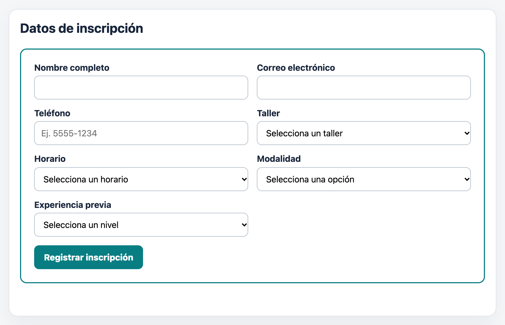
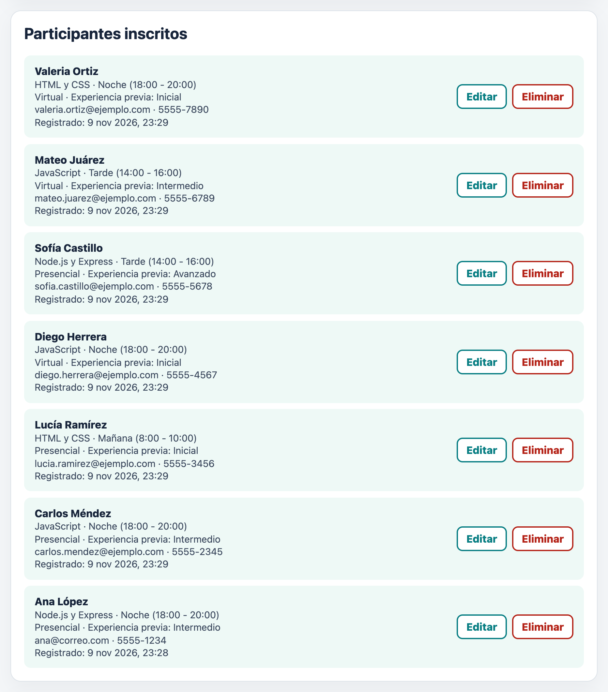
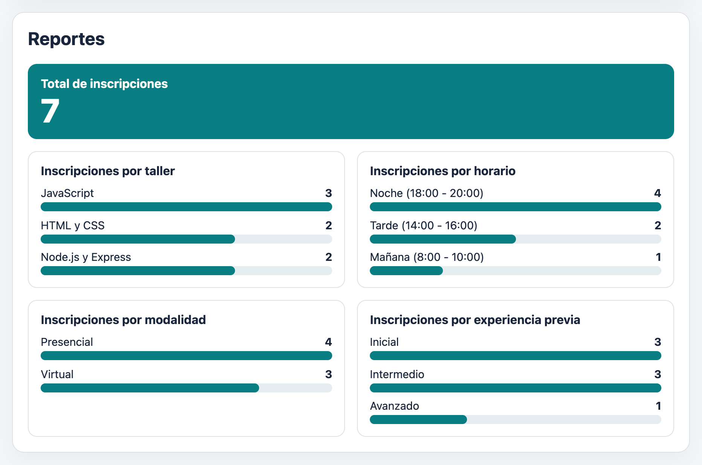
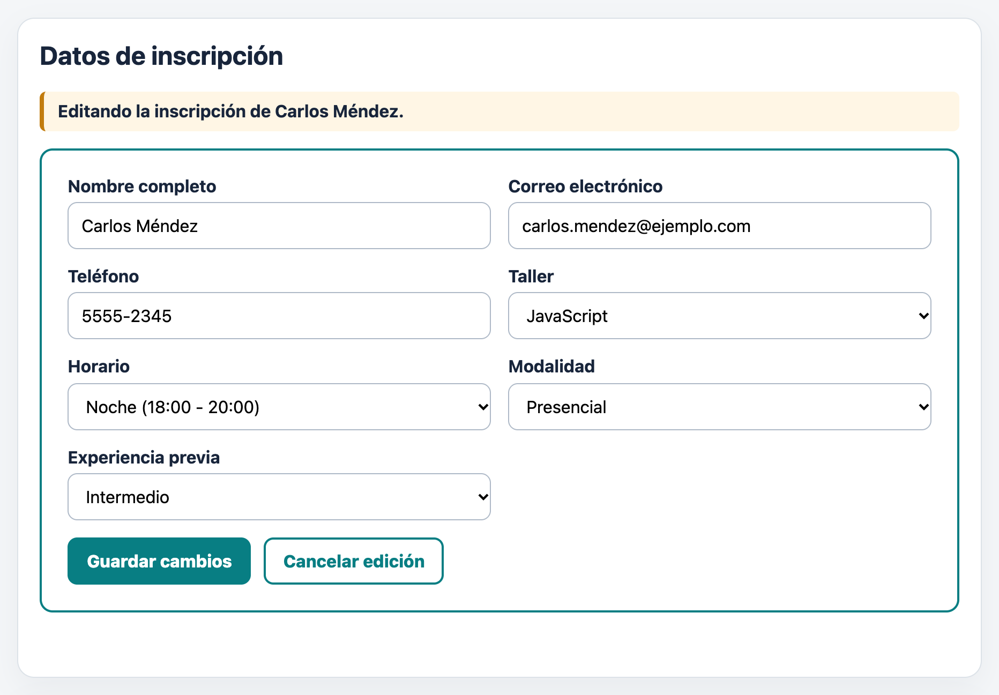
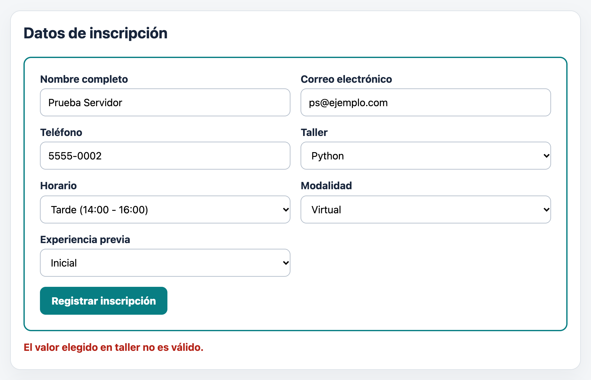
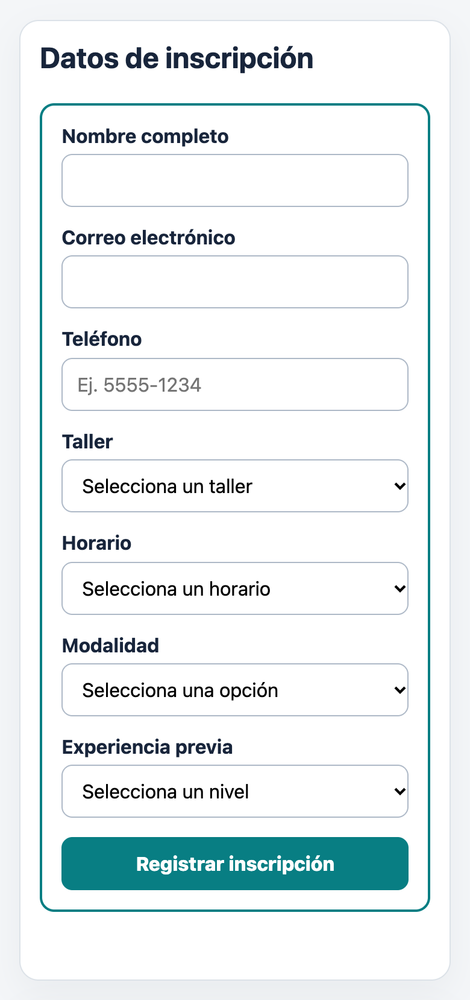
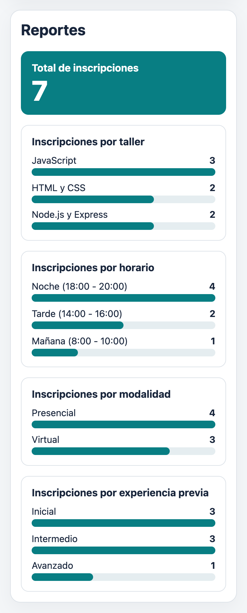

# Registro de participantes para un taller — versión final

Aplicación web para inscribirse a un taller de Desarrollo Web. Permite **crear, consultar, actualizar y eliminar** inscripciones desde la página y muestra **reportes visuales** calculados con los datos guardados en una base de datos **SQLite**.

**Tecnologías:** HTML, CSS, JavaScript (fetch), Node.js, Express 5 y SQLite (módulo integrado `node:sqlite`).



## Requisitos

- **Node.js 22.13 o posterior** (se recomienda la versión LTS). Compruébalo en la terminal de VS Code:

  ```bash
  node -v
  npm -v
  ```

- No hace falta instalar un servidor de base de datos: SQLite guarda todo en un archivo.

## Instalar y ejecutar

1. Abre la carpeta del proyecto en VS Code (**File → Open Folder**).
2. Abre **Terminal → New Terminal**.
3. Instala las dependencias (solo la primera vez):

   ```bash
   npm install
   ```

4. Inicia el servidor:

   ```bash
   npm start
   ```

5. Abre <http://localhost:3000> en el navegador.

Para detener el servidor, presiona `Ctrl + C` en la terminal.

> **Aviso normal al iniciar:** Node.js puede mostrar `ExperimentalWarning: SQLite is an experimental feature`. No es un error; el servidor funciona igual.

### Si PowerShell bloquea npm.ps1

Si aparece un mensaje que dice que la ejecución de scripts está deshabilitada, usa estos comandos en la misma terminal:

```powershell
npm.cmd install
npm.cmd start
```

También puedes cambiar el perfil de la terminal de VS Code a **Command Prompt** y usar `npm install` y `npm start`.

## Base de datos

La conexión está en `database.js`. Al iniciar el servidor:

1. `new DatabaseSync(...)` abre el archivo `registro_taller.db` junto a `server.js`, o lo crea si no existe.
2. `CREATE TABLE IF NOT EXISTS` crea la tabla `inscripciones` solo la primera vez.

| Columna | Tipo | Uso |
|---|---|---|
| `id` | INTEGER PRIMARY KEY AUTOINCREMENT | Identificador único; lo asigna SQLite. |
| `nombre`, `correo`, `telefono` | TEXT NOT NULL | Datos del participante. |
| `taller`, `horario` | TEXT NOT NULL | Selecciones del formulario. |
| `modalidad` | TEXT NOT NULL | **Campo nuevo:** Presencial o Virtual. |
| `nivel_experiencia` | TEXT NOT NULL | **Campo nuevo:** Inicial, Intermedio o Avanzado. |
| `fecha_registro` | TEXT NOT NULL DEFAULT CURRENT_TIMESTAMP | Fecha y hora (UTC) en que se guardó; la página la muestra en hora local. |

El archivo `registro_taller.db` **no se sube a GitHub**: está en `.gitignore` junto con `node_modules/` y `.env`. Cada persona que clone el repositorio obtiene una base vacía al ejecutar `npm start`.

> Si quieres empezar con la base vacía, detén el servidor y borra `registro_taller.db`. Se vuelve a crear al iniciar.

## API

Todas las rutas reciben y devuelven JSON. Las rutas que crean o actualizan usan **sentencias preparadas** (`?`), así el texto del usuario nunca se mezcla con la consulta SQL.

| Método y ruta | Qué hace | Respuestas |
|---|---|---|
| `GET /api/inscripciones` | Lee todas las inscripciones (la más reciente primero). | `200` con un arreglo |
| `POST /api/inscripciones` | Valida y guarda una inscripción nueva. | `201` creada · `400` datos inválidos |
| `PUT /api/inscripciones/:id` | Valida y actualiza la inscripción con ese id. | `200` · `400` datos o id inválidos · `404` no existe |
| `DELETE /api/inscripciones/:id` | Elimina la inscripción con ese id. | `200` · `400` id inválido · `404` no existe |
| `GET /api/reportes/resumen` | Conteos para los reportes visuales. | `200` con `total`, `porTaller`, `porHorario`, `porModalidad`, `porNivel` |

Ejemplo de cuerpo para `POST` y `PUT`:

```json
{
  "nombre": "Ana López",
  "correo": "ana@ejemplo.com",
  "telefono": "5555-1234",
  "taller": "JavaScript",
  "horario": "Tarde (14:00 - 16:00)",
  "modalidad": "Virtual",
  "nivel_experiencia": "Inicial"
}
```

Las respuestas correctas traen `mensaje` y las de error traen `error`, por ejemplo `{ "error": "Escribe un correo válido." }`.

## Validaciones

Se valida **dos veces**: en el navegador para ayudar a quien llena el formulario, y en Express porque cualquiera podría llamar a la API sin usar la página.

| Regla | Navegador (HTML) | Servidor (Express) |
|---|---|---|
| Todos los campos son obligatorios | `required` | Rechaza vacíos o con solo espacios (`trim()`) |
| Nombre de 2 a 80 caracteres | `minlength` / `maxlength` | Revisa la longitud |
| Correo con formato válido | `type="email"` | Expresión regular `^[^\s@]+@[^\s@]+\.[^\s@]+$` |
| Teléfono de 8 a 20 caracteres: números, espacios, `-` o `+` | `pattern` | Misma expresión regular |
| Taller, horario, modalidad y experiencia | `<select>` con opciones fijas | Comprueba que el valor esté en la lista de opciones permitidas |

Si algo falla, el servidor responde `400`, **no guarda nada**, y la página muestra el mensaje en rojo sin borrar lo que se escribió.

## Reportes

La sección **Reportes** de la página consulta `GET /api/reportes/resumen`, que calcula los datos directamente en la base:

```sql
SELECT COUNT(*) AS total FROM inscripciones;
SELECT taller, COUNT(*) AS cantidad FROM inscripciones GROUP BY taller ORDER BY cantidad DESC, taller;
SELECT horario, COUNT(*) AS cantidad FROM inscripciones GROUP BY horario ORDER BY cantidad DESC, horario;
SELECT modalidad, COUNT(*) AS cantidad FROM inscripciones GROUP BY modalidad ORDER BY cantidad DESC, modalidad;
SELECT nivel_experiencia, COUNT(*) AS cantidad FROM inscripciones GROUP BY nivel_experiencia ORDER BY cantidad DESC, nivel_experiencia;
```

La página muestra el total en una tarjeta destacada y cada agrupación con barras. La barra más larga corresponde al grupo con más inscripciones. Después de crear, editar o eliminar, la lista y los reportes se vuelven a consultar. Si no hay registros aparece *"Todavía no hay inscripciones para reportar."*

## Cómo probar cada operación

### Desde la página

1. **Crear:** llena el formulario y presiona **Registrar inscripción**. Aparece en la lista y el total sube.
2. **Leer:** recarga la página; la lista se llena con lo que hay en la base.
3. **Actualizar:** presiona **Editar** en una fila. Sus datos se cargan en el formulario, el botón cambia a **Guardar cambios** y aparece **Cancelar edición**. Cambia algo y guarda.
4. **Eliminar:** presiona **Eliminar** y confirma. La fila desaparece y los reportes se actualizan.
5. **Persistencia:** detén el servidor (`Ctrl + C`), vuelve a ejecutar `npm start` y recarga: los datos siguen ahí.

### Desde la terminal (macOS, Linux o Git Bash)

Con el servidor encendido, en otra terminal:

```bash
# Leer
curl http://localhost:3000/api/inscripciones

# Crear (responde 201)
curl -X POST http://localhost:3000/api/inscripciones \
  -H "Content-Type: application/json" \
  -d '{"nombre":"Ana López","correo":"ana@ejemplo.com","telefono":"5555-1234","taller":"JavaScript","horario":"Tarde (14:00 - 16:00)","modalidad":"Virtual","nivel_experiencia":"Inicial"}'

# Correo inválido (responde 400 y no guarda)
curl -X POST http://localhost:3000/api/inscripciones \
  -H "Content-Type: application/json" \
  -d '{"nombre":"Ana López","correo":"sin-arroba","telefono":"5555-1234","taller":"JavaScript","horario":"Tarde (14:00 - 16:00)","modalidad":"Virtual","nivel_experiencia":"Inicial"}'

# Actualizar la inscripción 1
curl -X PUT http://localhost:3000/api/inscripciones/1 \
  -H "Content-Type: application/json" \
  -d '{"nombre":"Ana López","correo":"ana@ejemplo.com","telefono":"5555-1234","taller":"Node.js y Express","horario":"Noche (18:00 - 20:00)","modalidad":"Presencial","nivel_experiencia":"Intermedio"}'

# Eliminar la inscripción 1 (si se repite, responde 404)
curl -X DELETE http://localhost:3000/api/inscripciones/1

# Reportes
curl http://localhost:3000/api/reportes/resumen
```

### Resultados de las pruebas

| Prueba | Resultado esperado | Estado |
|---|---|---|
| Crear | `POST` guarda una fila; aparece en la lista y en los reportes. | ✅ |
| Leer | `GET` muestra las inscripciones guardadas en la base. | ✅ |
| Actualizar | `PUT` modifica la fila correcta y la lista muestra el cambio. | ✅ |
| Eliminar | `DELETE` elimina la fila y actualiza lista y reportes; repetirlo da `404`. | ✅ |
| Validación | Correo inválido, campo vacío, teléfono con letras u opción inexistente responden `400` y no se guardan. | ✅ |
| Persistencia | Al reiniciar el servidor, los datos continúan. | ✅ |
| Diseño | Dos columnas en escritorio, una columna en móvil y sin desplazamiento horizontal a 390 px. | ✅ |
| Reporte | El total y cada agrupación coinciden con la base. | ✅ |

## Capturas

Todas las capturas usan **datos inventados**.

| Lista con acciones Editar y Eliminar | Reporte visual |
|---|---|
|  |  |

| Editando una inscripción (PUT) | Express rechaza un valor inválido |
|---|---|
|  |  |

| Móvil: formulario | Móvil: reportes |
|---|---|
|  |  |

## Estructura del proyecto

```
registro-taller-estudiante/
├── server.js          # Servidor Express: rutas de la API y validaciones
├── database.js        # Conexión SQLite y creación de la tabla inscripciones
├── public/
│   ├── index.html     # Formulario, lista y sección de reportes
│   ├── styles.css     # Estilos y diseño adaptable
│   └── app.js         # fetch a la API, edición, eliminación y barras
├── docs/capturas/     # Evidencias de funcionamiento
├── package.json
├── .gitignore         # Excluye node_modules/, .env y registro_taller.db
├── README.md
└── bitacora.md
```
